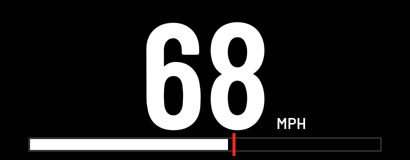
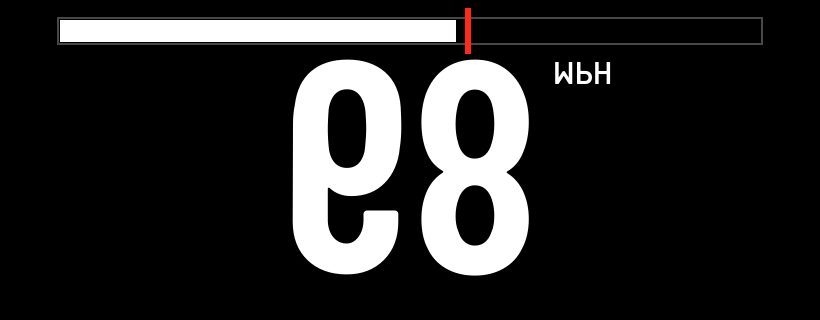
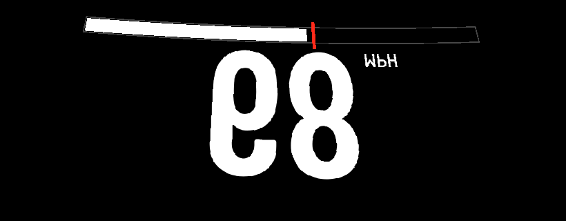

# Head-up display (HUD)

In HUD mode the screen lies flat on the dashboard, below the windscreen, and the driver
reads the speed in its reflection. The firmware draws the HUD the right way round for the
driver and then pre-distorts it, so that after the reflection it looks upright, straight
and level.

| What the driver should see | What the panel shows (mirrored only) | What the panel shows (mirrored and shaped) |
|---|---|---|
|  |  |  |

The images are produced by `tools/render_hud.py`, which uses the same maths as the
firmware. The right-hand example has 0.88 width, 0.85 height, 0.12 keystone, 0.10
curvature, 0.05 skew and -1.5 degrees rotation.

## Mounting

1. Put the screen face up on the dashboard in front of the driver, as close to the bottom
   of the windscreen as it will go. The default **Mirror top to bottom** setting expects
   the screen's top edge (the edge above the speed digits on the dashboard designs)
   towards the windscreen.
2. If you mount it with the bottom edge towards the windscreen instead, turn on
   **Mirror left to right** and turn off **Mirror top to bottom**. If the USB lead has to
   come out of the other side, use **Rotation 180°**: it turns the HUD and the dashboard
   designs together.
3. A reflection off plain glass is faint in daylight. A strip of HUD reflective film on the
   inside of the windscreen gives a much brighter image and removes the faint second
   image from the outer surface of the glass.

The reflection of an LCD is affected by polarisation. If the image is much fainter than
expected, or vanishes with polarised sunglasses, a HUD film usually fixes it.

## Adjusting the shape

Open the settings page (`http://ex30-speedo.local` or the device's IP address) on a phone
while sitting in the driving position. Changes in **Head-up display** show on the screen
straight away; press **Save HUD** to keep them.

1. Turn on **Show test grid while adjusting**. The grid has a border, a centre cross, a
   circle and the words TOP, LEFT and RIGHT.
2. If TOP, LEFT or RIGHT read backwards or upside down, change the mirror settings first.
3. Move the sliders until the grid looks right in the windscreen:

| Slider | Fixes | Range |
|---|---|---|
| Width, Height | Overall size. The windscreen's rake squashes the image vertically, so Height usually needs to go up, or Width down, to make the circle round. | 0.5 to 1.5 |
| Keystone | Top and bottom edges of different widths (trapezium). + makes the top wider. | -0.5 to 0.5 |
| Side taper | Left and right edges of different heights, from viewing the windscreen at an angle. + makes the right side taller. | -0.5 to 0.5 |
| Curvature | Horizontal lines that bow, from the windscreen's curve. + lowers the ends. | -0.5 to 0.5 |
| Skew | Vertical lines that lean. + leans the top to the right. | -0.5 to 0.5 |
| Rotate | The whole image tilted. + turns it clockwise. | -15 to 15 degrees |
| Move | Position in the windscreen. | ±300 px across, ±150 px up and down |

All sliders describe the image as the driver sees it, after the reflection, so they work
the same way whatever the mirror settings are. **Reset shape** puts them all back to no
correction.

4. Turn off the test grid and press **Save HUD**.

The same settings can be sent as JSON to `POST /api/hud`, for example
`{"keystone":0.1,"save":true}`. Only the fields given are changed. Without `"save":true`
the change is not stored and is lost at the next restart.

## What is shown

By default the HUD only shows the speed and a speed gauge, in white on black. Each part
can be changed on the settings page:

| Option | Choices | Default |
|---|---|---|
| Speed gauge | Off, bar, segments | Bar |
| Gauge full scale | 0 (120 mph or 200 km/h), or any value up to 300 | 0 |
| Digit size | Medium (220 px font), large (300 px font) | Large |
| Show units | MPH or KM/H to the right of the digits | On |
| Show alert limit on gauge | Red marker at the alert limit (Display: Alert limit) | On |
| Show clock | Clock in the top-left corner | Off |
| Warn when there is no GPS fix | NO GPS / NO GPS FIX in the top-right corner | On |
| Colour | Digits and gauge | White |
| Colour after dark | Used instead when *Switch to D automatically at night* is on and the sun is down | Green |
| Over the limit | Digits and gauge above the alert limit | Red |

Black pixels on an LCD still let some backlight through, so at night the whole screen can
show as a faint grey rectangle. Lower the brightness, or let *Auto by sun* do it.

On the device, hold BOOT for the settings menu. *HUD mode*, *HUD mirror*, *HUD gauge*,
*HUD digits*, *HUD test grid* and *Rotation* are at the top. A short press on the driving
screen steps through the designs: A, B1, B2, C, D, HUD, then back to A.

The settings menu, status page and firmware update screen are also shown through the HUD
mirror and shape. The Wi-Fi setup page is not, so its QR code can be scanned from the
screen itself.

## How it is drawn

- The HUD is drawn upright into an 820 x 320 RGB332 image in PSRAM (262 KB).
- For every screen pixel, the firmware works out which pixel of that image it should
  show, by undoing in reverse order: the mirror (and rotation), the move, the rotation,
  the skew, the curvature, the keystone, the side taper and the size. This is worked out
  exactly at the corners of 8 x 8 pixel cells and interpolated inside each cell.
- Only the cells whose part of the image changed are warped again, into the back frame
  buffer, which is then swapped in. This keeps the PSRAM traffic down: see
  [display.md](display.md) for why that matters on this panel.
- Moving a slider rebuilds the cell corners and warps the whole frame once.
